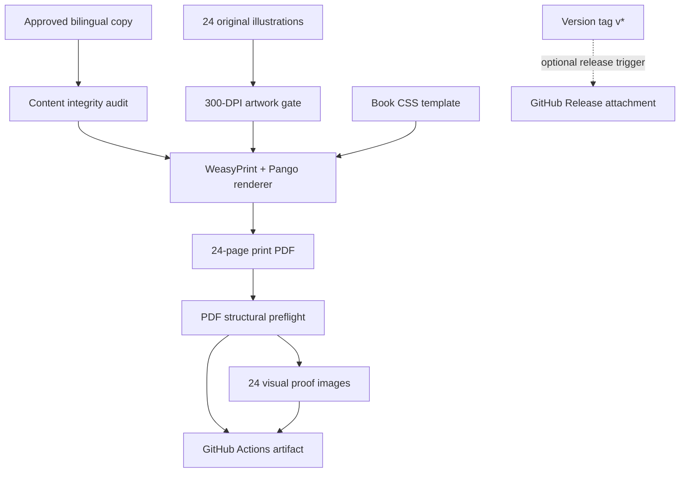

# The Happy Little Train — Bilingual KDP Production Pipeline

[](https://www.python.org/)
[](.github/workflows/build.yml)
[](#proof-of-concept--enterprise-customization-readiness)
[](#proof-of-concept--enterprise-customization-readiness)

A reproducible Python and GitHub Actions pipeline for building and structurally validating a 24-page Arabic/English children's paperback interior. It combines approved bilingual content, original page artwork, HTML/CSS pagination, PDF box geometry, embedded-font checks, visual proofs, and downloadable build artifacts.

The pipeline does **not** publish directly to Amazon KDP and cannot guarantee acceptance by KDP. Human visual review and KDP Print Previewer remain required.

## 1. Project Overview & Problem Statement

Print-ready children's books require more than exporting images into a PDF. Page count, trim and bleed geometry, artwork resolution, language text layers, font embedding, and visual consistency must all be checked before a manuscript is submitted.

This repository provides a repeatable production path for *The Happy Little Train*:

- Stores the approved English and Arabic page copy and parent-child activity prompts in `book/content.py`.
- Requires 24 original illustrations under `assets/artwork/`; missing, undersized, or unsupported artwork stops the build.
- Renders each page through WeasyPrint and Pango using the repository's CSS template.
- Produces an 8.5 × 8.5 in trim interior with the configured 0.125 in bleed geometry.
- Checks the PDF's page count, media/trim/bleed boxes, Arabic and English text layer, activity prompts, artwork images, and embedded font programs.
- Creates page proof images and uploads the validated PDF and proofs as a GitHub Actions artifact.
- Can attach the validated PDF to a GitHub Release when a version tag is pushed.

### Architecture



The content audit, artwork audit, and render/preflight jobs run as separate workflow stages. Rendering is gated on both audits succeeding.

## 2. Tech Stack & Versions

| Area | Repository-backed implementation |
|---|---|
| Runtime | Python 3.12 in GitHub Actions |
| PDF / HTML rendering | WeasyPrint 68.1 |
| PDF inspection and page-box editing | pypdf 5.1.0 |
| Artwork inspection | Pillow 11.0.0 |
| Layout and shaping | HTML/CSS, Pango, Cairo, HarfBuzz via the runner's native libraries |
| Arabic and Latin fonts | Noto and DejaVu font packages installed by CI |
| PDF utilities | qpdf and Poppler utilities |
| Automation | GitHub Actions, checkout v4, setup-python v5, upload-artifact v4 |
| Release publishing | softprops/action-gh-release v2 on version tags |

Python dependencies are pinned in [requirements.txt](requirements.txt). Native rendering libraries and fonts are installed by the workflow on Ubuntu 24.04.

## 3. Prerequisites & Dependencies

### Local build requirements

- Python 3.12.
- The native Pango/Cairo/GLib dependencies required by WeasyPrint.
- Arabic-capable fonts, including Noto fonts.
- qpdf and Poppler utilities for the full validation workflow.
- All 24 original illustrations in `assets/artwork/`.

The GitHub Actions workflow installs the native libraries and fonts on its Ubuntu runner. Local setup must provide equivalent system packages.

### Artwork requirements

The artwork gate expects one image for each page, named `page-01` through `page-24`, with PNG, JPG, JPEG, or WebP extensions.

- Minimum dimensions: 2588 × 1716 pixels.
- Accepted color modes: RGB or RGBA.
- All 24 images must be present and pass the resolution/mode checks.
- Placeholder geometry or synthetic fallback images are not substituted for missing artwork.

## 4. Installation & Local Setup

Clone the repository:

```bash
git clone https://github.com/zopair/Amazon-work-.git
cd Amazon-work-
```

Create and activate a virtual environment, then install the Python dependencies:

```bash
python3.12 -m venv .venv
source .venv/bin/activate
python -m pip install --upgrade pip
python -m pip install -r requirements.txt
```

Install the native libraries, fonts, qpdf, and Poppler utilities for your operating system. The exact Ubuntu package set is documented in [the build workflow](.github/workflows/build.yml).

Run the content audit:

```bash
python -m book.content_check
```

Run the artwork audit:

```bash
python -m book.inputs --report dist/artwork-preflight.json
```

Render and validate the PDF:

```bash
python -m book.render
python -m book.preflight dist/the-happy-little-train-print.pdf
qpdf --check dist/the-happy-little-train-print.pdf
pdfinfo dist/the-happy-little-train-print.pdf
```

The renderer writes `dist/the-happy-little-train-print.pdf`. It refuses to render unless all 24 original illustrations pass the required checks.

## 5. Environment Variables

No application environment variables or API credentials are required by the current build pipeline.

| Configuration | Current behavior |
|---|---|
| GitHub Actions permissions | Workflow declares `contents: read` globally and grants `contents: write` only to the render/release job |
| Release tag | A tag matching `v*` triggers the optional GitHub Release attachment step |
| External service credentials | None required |
| KDP credentials | Not used; the workflow does not log in to or publish to KDP |

Do not add KDP passwords, OAuth tokens, or unrelated service credentials to this repository. The current pipeline has no need for them.

## 6. Usage Guide & Core Features

### Content source

The bilingual page data and parent-child activity prompts are maintained in `book/content.py`. The workflow runs `book.content_check` as an independent content-integrity gate.

### Artwork validation

`book.inputs` checks the 24 expected page illustrations, minimum dimensions, and RGB/RGBA mode. It can write a machine-readable JSON report. The renderer repeats the hard validation before producing a PDF, so bypassing the earlier workflow stage does not bypass the artwork requirement.

### PDF rendering

`book.render` uses the HTML/CSS template at `book/templates/book.css`, embeds the local artwork, and writes the PDF with the configured page boxes and metadata.

### Structural preflight

`book.preflight` verifies:

- Exactly 24 PDF pages.
- Expected media and bleed dimensions and 8.5 × 8.5 in trim dimensions.
- Arabic text and a non-empty text layer on every page.
- The expected “Mom's Turn” activity prompt on every page.
- Embedded artwork image resources and at least one embedded font program per page.

A successful structural preflight is not a visual-quality certification or a KDP approval.

### GitHub Actions outputs

On a successful build, the workflow uploads:
- The print PDF.
- 24 rendered PNG page proofs.

The artifact retention period is 30 days. A version tag matching `v*` additionally publishes the validated PDF as a GitHub Release asset.

## 7. Live Demo & Screenshots

This repository is a production pipeline, not a hosted web application. No interactive live demo is currently deployed.

The workflow generates 24 visual proof images and publishes them with the PDF as the `happy-little-train-print-ready` Actions artifact. The artwork audit also uploads its JSON report when available, including when the artwork gate fails.

To inspect a build, open the repository's **Actions** tab, select a successful run, and download its artifacts. A successful CI run is not a substitute for checking all pages visually.

## 8. Testing & Verification

The current automated verification is implemented as workflow gates:

| Check | Verification |
|---|---|
| Content integrity | `python -m book.content_check` |
| Artwork readiness | `python -m book.inputs --report dist/artwork-preflight.json` |
| Rendering | `python -m book.render` |
| PDF structure and text | `python -m book.preflight dist/the-happy-little-train-print.pdf` |
| PDF syntax | `qpdf --check` |
| Page proofs | Poppler renders the PDF; workflow asserts exactly 24 proof images |
| CI environment | Ubuntu 24.04, Python 3.12 |

The workflow is triggered by pushes to `main`, version tags matching `v*`, and manual dispatch. The repository does not claim that a PDF has passed KDP's own Print Previewer unless that external review has actually been completed.

## Proof of Concept & Enterprise Customization Readiness

**Status: Implemented production-pipeline PoC; final publishing readiness depends on approved artwork, visual review, and the target platform's acceptance checks.**

| Area | Current state |
|---|---|
| Bilingual content source | Implemented in Python |
| Original artwork gate | Implemented; all 24 source images are mandatory |
| PDF renderer | Implemented with WeasyPrint/Pango |
| Structural PDF preflight | Implemented |
| Visual proof generation | Implemented in GitHub Actions |
| Artifact delivery | Implemented with 30-day retention |
| Automated KDP submission | Not implemented |
| KDP acceptance | Not guaranteed; manual Print Previewer review required |
| Hosted application | Not applicable; this is a build pipeline |

### Known limitations

- The pipeline cannot verify subjective illustration quality, text readability, or every visual layout defect automatically.
- Structural checks do not replace opening and reviewing all 24 rendered page proofs.
- KDP trim, bleed, language-direction, and content policies can change; confirm current requirements in KDP before submission.
- No automated publishing or account interaction with Amazon KDP is performed.

### Change log

- **2026-11-26:** Reworked the repository README to document the actual pipeline, dependencies, local commands, CI gates, artifacts, limitations, and authorship. No application code or workflow behavior changed.

## Intellectual Property & Authorship

Project authorship and requested attribution: **Aly Hussein Zopair (علي حسين زبير ALY HUSSEIN ZOPAIR)**.

The book's text and illustrations must be original or otherwise properly licensed for the intended commercial print use. This attribution does not transfer ownership of third-party libraries, fonts, workflow actions, or other separately licensed materials, and this repository does not grant a license unless a separate LICENSE file states one.
